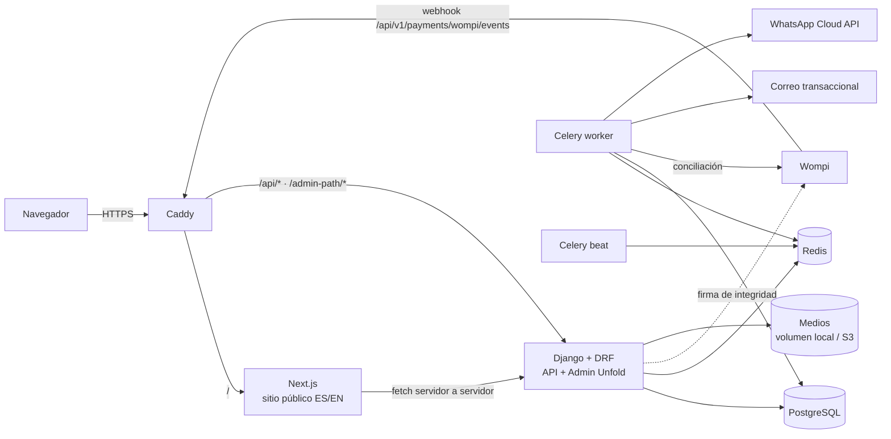

# Arquitectura

## Vista general



Todo corre en el VPS del equipo con Docker Compose (DC-12). Un solo dominio (ADR-003).

## Revisión del stack

| Pieza | Veredicto | Motivo |
|---|---|---|
| Next.js + TypeScript + React (App Router) | ✅ | SSR/ISR para SEO, rutas localizadas, imágenes |
| Tailwind CSS | ✅ | Tokens de marca como variables CSS (DC-06) |
| shadcn/ui | ✅ con matiz | Primitivas accesibles (Dialog, Sheet, Select); el sitio público usa componentes propios sobre ellas, no su estilo por defecto |
| Motion | ✅ opcional | Solo revelados y la transición de paneles; respeta `prefers-reduced-motion` |
| Django + DRF | ✅ | Monolito modular (ADR-001) |
| Dashboard | 🔁 Django Admin + Unfold | ADR-002 |
| CMS | 🔁 Modelos propios | ADR-004 |
| `django-modeltranslation` | ➕ | ADR-005 |
| PostgreSQL | ✅ | Búsqueda con `unaccent` + `pg_trgm` (sin Elasticsearch) |
| Redis + Celery (+ beat) | ✅ | Notificaciones, conciliación con Wompi, vencimiento de reservas, procesamiento de imágenes, *rate limiting* |
| Caddy | ✅ | HTTPS automático, cabeceras de seguridad, rutas por prefijo |
| `django-storages` | ✅ | Interfaz S3; volumen local en el MVP |
| Pillow | ➕ | Re-codificación y versiones WebP (ADR-010) |
| `argon2-cffi`, `django-axes`, `django-otp` | ➕ | Hash de contraseñas, bloqueo por intentos, 2FA |
| `drf-spectacular` | ✅ | OpenAPI generado desde el código |
| Pytest, Playwright, Ruff, mypy + django-stubs, `tsc --strict`, ESLint | ✅ | Calidad |
| GitHub Actions | ✅ | CI |
| Sentry | ➕ | Errores en backend y frontend |
| Correo transaccional (SES, Postmark o Resend) | ➕ por decidir (P-13) | Nunca SMTP directo desde el VPS |

**Dependencias que evitamos:** Wagtail, Elasticsearch, GraphQL, microservicios, gestores de estado global en el frontend.

## Estructura del repositorio

```
serti_attelier/
├── backend/
│   ├── config/                # settings/{base,dev,prod,test}.py, urls, celery, wsgi/asgi
│   ├── apps/
│   │   ├── core/              # Money, utilidades i18n, storage, SiteSettings, ubicaciones DANE, health
│   │   ├── accounts/          # usuarios admin, roles, 2FA, recuperación de contraseña
│   │   ├── catalog/           # categorías, colecciones, piedras, materiales, piezas, imágenes
│   │   ├── inventory/         # reservas de piezas únicas e historial de estados
│   │   ├── cms/               # home, banners, páginas, revisiones, vista previa
│   │   ├── cart/              # carrito invitado
│   │   ├── pricing/           # cálculo de totales — servicio puro
│   │   ├── promotions/        # cupones
│   │   ├── shipping/          # cobertura Colombia, envío gratis
│   │   ├── orders/            # pedidos, ítems, estados, historial
│   │   ├── payments/          # canales (Wompi, manual), intentos, eventos, conciliación
│   │   ├── notifications/     # adaptadores, plantillas, entregas
│   │   └── audit/             # AuditLog
│   ├── templates/emails/      # correos ES/EN
│   ├── pyproject.toml
│   └── tests/                 # pruebas transversales (E2E de API)
├── frontend/
│   ├── app/[locale]/          # rutas localizadas
│   ├── components/
│   ├── lib/                   # cliente API tipado (generado desde OpenAPI), i18n, wishlist
│   ├── messages/{es,en}.json  # textos de interfaz
│   └── tests/e2e/             # Playwright
├── infra/
│   ├── docker-compose.yml     # producción
│   ├── docker-compose.dev.yml
│   ├── Caddyfile
│   └── scripts/               # backup, restore, deploy
├── docs/
└── .github/workflows/
```

## Organización de cada app

```
models.py       # datos y restricciones de base de datos
services.py     # casos de uso; única puerta de escritura; @transaction.atomic
selectors.py    # consultas de lectura optimizadas
api/            # serializers (forma), views (delgadas), permissions, urls
admin.py        # Unfold
tasks.py        # Celery
tests/
```

**Reglas**

1. Vistas y serializers no contienen reglas de negocio: llaman a `services`.
2. Una app no escribe en modelos de otra; usa sus servicios públicos (p. ej., `payments` llama a `orders.services.mark_paid()`).
3. Dinero en centavos enteros (ADR-006).
4. Toda escritura que toca una pieza usa `select_for_update()` sobre la fila de la pieza.
5. Efectos externos (correo, WhatsApp) solo con `transaction.on_commit`.
6. Errores de dominio como excepciones tipadas (`PieceNotAvailable`, `CouponInvalid`…), traducidas a `application/problem+json` en una sola capa.

## Responsabilidades por módulo

| Módulo | Responsable de | Depende de |
|---|---|---|
| `core` | Dinero, configuración del sitio, ubicaciones DANE, health | — |
| `accounts` | Usuarios admin, roles, 2FA, contraseñas | `audit` |
| `catalog` | Taxonomías, piezas, imágenes, SEO, publicación y ocultamiento (DC-16) | `core` |
| `inventory` | Reservar, liberar, convertir; estados de venta | `catalog` |
| `cms` | Secciones del home, banners, páginas, revisiones | `catalog` |
| `cart` | Carrito por token | `catalog`, `inventory` (lectura) |
| `pricing` | Subtotal, descuento, envío, total | `catalog`, `promotions`, `shipping` |
| `promotions` | Validar y redimir cupones | — |
| `shipping` | Cobertura y tarifa (DC-01) | `core` |
| `orders` | Crear pedido idempotente; máquina de estados | `pricing`, `inventory` |
| `payments` | Canales Wompi y manual; webhook; conciliación | `orders` |
| `notifications` | Encolar, enviar, reintentar | `orders` (lectura) |
| `audit` | Registro de acciones | — |

## Procesos en segundo plano (Celery beat)

| Tarea | Frecuencia | Qué hace |
|---|---|---|
| `payments.reconcile_pending_wompi` | 5 min | Consulta en Wompi los intentos `PENDING` con más de 10 min y aplica el estado real |
| `inventory.release_expired_reservations` | 1 min | Libera reservas vencidas (online y manuales de 24 h) y expira sus pedidos |
| `notifications.retry_failed` | 10 min | Reintenta entregas fallidas con *backoff*, hasta el máximo configurado |
| `orders.alert_needs_attention` | 15 min | Avisa a SERTI de pedidos `needs_attention` (pago aprobado sobre pieza ya vendida) |
| `core.backup_database` | Diario | `pg_dump` cifrado al almacenamiento externo (también puede ir como cron del host) |

## Entornos

| Entorno | Dónde | Wompi | Correo | WhatsApp |
|---|---|---|---|---|
| `dev` | Local, `docker-compose.dev.yml`, `https://serti.localhost` | Sandbox | Consola / Mailpit | Adaptador simulado |
| `staging` | VPS, subdominio protegido | Sandbox | Proveedor real con lista blanca | Número de prueba de Meta |
| `prod` | VPS, dominio del cliente | Producción | Proveedor real | Número verificado |

Variables de entorno: ver `.env.example` (se crea en la Fase 1) y [integrations.md](integrations.md).
