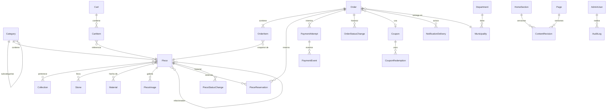
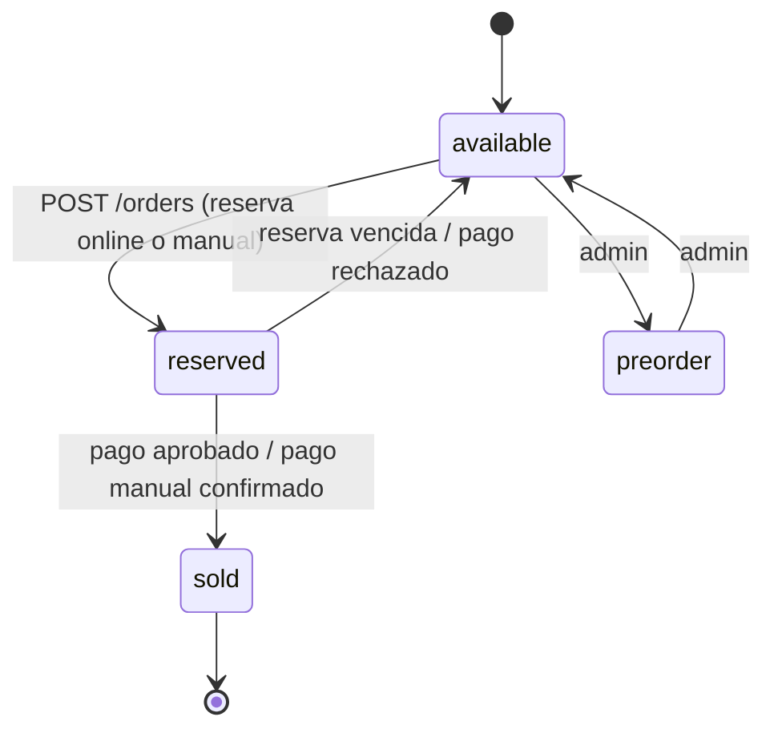
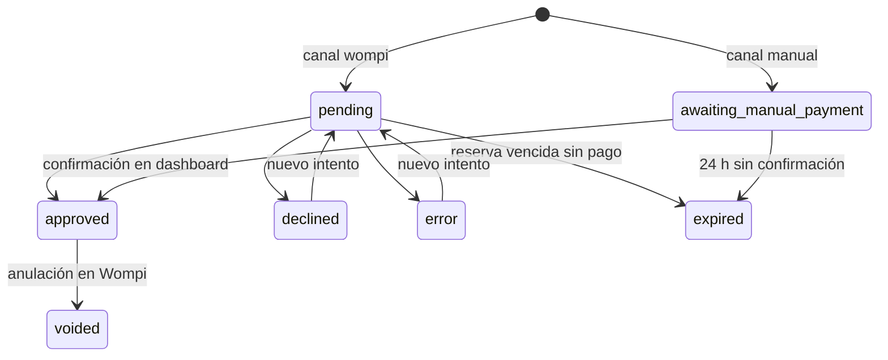

# Diseño de base de datos

PostgreSQL 16. Migraciones versionadas con Django. Convenciones:

- Claves primarias `bigint` autoincrementales internas; identificadores públicos aleatorios (`public_token`, UUID/128 bits) donde una URL expone un recurso.
- Campos traducibles con sufijo `_es` / `_en` (ADR-005). En las tablas se escribe `name_*`.
- Dinero en centavos COP, `bigint` (ADR-006).
- `created_at` / `updated_at` en todas las tablas (omitidos abajo).
- Extensiones: `unaccent`, `pg_trgm`.

## Diagrama entidad-relación

> En el código el modelo de pieza se llama `Piece` (el producto es la pieza, ADR-007).

## Catálogo

### `catalog_category`
| Campo | Tipo | Notas |
|---|---|---|
| `name_*`, `slug_*`, `description_*`, `seo_title_*`, `seo_description_*` | text | — |
| `parent_id` | FK self, null | Máximo un nivel (validado en servicio) |
| `cover_image` | FK `PieceImage`/media | 16:9 |
| `position` | int | Orden manual |
| `is_active` | bool | — |

Restricciones: `UNIQUE(slug_es)`, `UNIQUE(slug_en)`; `CHECK(parent_id <> id)`.

### `catalog_collection`
Regalos, Novedades y Destacados, Sets, Descuentos. Campos: `name_*`, `slug_*`, `description_*`, `cover_image`, `position`, `is_active`, `seo_*`. Relación M:N con piezas mediante `catalog_collection_piece(collection_id, piece_id, position)` con `UNIQUE(collection_id, piece_id)`.

### `catalog_stone` / `catalog_material`
`name_*`, `slug_*`, `description_*`, `cover_image` (16:9, solo piedras), `position`. Slugs únicos.

### `catalog_piece`
| Campo | Tipo | Notas |
|---|---|---|
| `sku` | varchar(40) | `UNIQUE` |
| `piece_number` | varchar(20), null | Número de pieza para el certificado (DC-15) |
| `name_*`, `slug_*` | text | `UNIQUE(slug_es)`, `UNIQUE(slug_en)` |
| `short_description_*`, `long_description_*`, `story_*`, `care_*` | text | — |
| `category_id` | FK `PROTECT` | — |
| `status` | enum `draft · published · hidden · archived` | `hidden` = oculta del catálogo (DC-16) |
| `sale_state` | enum `available · reserved · sold · preorder` | Ver máquina de estados |
| `is_new` | bool | Etiqueta "nuevo" |
| `price_cents` | bigint | `CHECK(price_cents > 0)` |
| `sale_price_cents` | bigint, null | `CHECK(sale_price_cents IS NULL OR (sale_price_cents > 0 AND sale_price_cents < price_cents))` |
| `attributes` | jsonb | Validado por esquema: `ring_size`, `length_mm`, `metal`, `metal_purity`, `carats`, `weight_g`, `dimensions_mm` |
| `seo_title_*`, `seo_description_*` | text | — |
| `published_at`, `sold_at` | timestamptz, null | — |
| `search_vector_*` | generada | `unaccent` + trigram para el buscador |

Índices: `(status, sale_state)`; `(category_id, status)`; GIN trigram sobre `unaccent(name_es)` y `unaccent(name_en)`; `(published_at DESC)` para "Novedades".

Relaciones M:N: `piece_stone`, `piece_material`, `piece_related(from_id, to_id)` con `CHECK(from_id <> to_id)`.

### `catalog_pieceimage`
`piece_id`, `original` (ruta), `renditions` (jsonb: `{ "webp": { "480": ruta, "960": ruta, "1600": ruta } }`), `width`, `height`, `ratio`, `alt_*`, `position`, `is_primary`. Restricción: `UNIQUE(piece_id, position)` e índice único parcial `UNIQUE(piece_id) WHERE is_primary`.

## Inventario de piezas únicas

### `inventory_piecereservation`
| Campo | Tipo | Notas |
|---|---|---|
| `piece_id` | FK | — |
| `order_id` | FK | — |
| `kind` | enum `online · manual` | `manual` = 24 h (DC-14) |
| `status` | enum `active · released · converted` | — |
| `expires_at` | timestamptz | — |

Restricciones clave:
- **`UNIQUE(piece_id) WHERE status = 'active'`** → una pieza nunca tiene dos reservas activas.
- Índice `(status, expires_at)` para la tarea que libera vencidas.

### `inventory_piecestatuschange`
Solo inserción: `piece_id`, `from_state`, `to_state`, `reason` (`checkout`, `payment_approved`, `manual_payment_confirmed`, `reservation_expired`, `admin`), `ref` (pedido o usuario), `actor_id`.

### Máquina de estados de la pieza (`sale_state`)

`sold` es terminal. Solo el servicio `inventory` cambia `sale_state`.

## Carrito

- `cart_cart`: `token` (UUID4, `UNIQUE`), `locale`, `expires_at`.
- `cart_cartitem`: `cart_id`, `piece_id`, `added_at`; `UNIQUE(cart_id, piece_id)`. Sin cantidad (siempre 1).

## Pedidos

### `orders_order`
| Campo | Tipo | Notas |
|---|---|---|
| `number` | varchar | `SRT-000123`, `UNIQUE`, secuencia propia |
| `public_token` | varchar(43) | 256 bits base64url, `UNIQUE`; único identificador en URLs públicas |
| `idempotency_key` | varchar(64) | `UNIQUE` |
| `locale` | enum `es · en` | Idioma de las comunicaciones |
| `customer_name`, `customer_email`, `customer_phone`, `customer_id_number` *(si Wompi o la entrega lo exigen)* | text | Datos personales mínimos |
| `shipping_address_line`, `shipping_address_extra`, `shipping_municipality_id`, `shipping_notes` | — | Colombia (DC-01) |
| `subtotal_cents`, `discount_cents`, `shipping_cents`, `total_cents` | bigint | `CHECK(total_cents = subtotal_cents - discount_cents + shipping_cents)`; `CHECK(total_cents > 0)` |
| `currency` | char(3) | `COP` |
| `coupon_id` | FK, null | — |
| `payment_channel` | enum `wompi · manual` | ADR-008 |
| `payment_status` | enum | Ver abajo |
| `fulfillment_status` | enum | Ver abajo |
| `wants_certificate` | bool | DC-15 |
| `terms_version`, `privacy_version`, `privacy_consent_at` | — | LEG-01, LEG-03 |
| `needs_attention` | bool | Pago aprobado sobre una pieza que ya no estaba reservada |
| `paid_at` | timestamptz, null | — |

Índices: `(payment_status, created_at DESC)`, `(fulfillment_status)`, `(customer_email)` (búsqueda en el admin).

### `orders_orderitem`
Snapshot inmutable: `order_id`, `piece_id` (`PROTECT`), `sku`, `piece_number`, `name_es`, `name_en`, `attributes`, `unit_price_cents`, `discount_cents`, `image_path`.

### `orders_orderstatuschange`
Solo inserción: `order_id`, `field` (`payment_status` | `fulfillment_status`), `from`, `to`, `actor_id` (null = sistema), `note`.

### Estados del pedido

**Pago (`payment_status`)**

**Operación (`fulfillment_status`):** `unfulfilled → preparing → shipped → delivered`, más `cancelled` y `returned`. No se puede pasar a `preparing` sin `payment_status = approved`.

## Pagos

### `payments_paymentattempt`
| Campo | Notas |
|---|---|
| `order_id` | — |
| `channel` | `wompi · manual` |
| `reference` | `UNIQUE`; una nueva por intento (`SRT-000123-02`) |
| `amount_cents`, `currency` | Copia del total al crear el intento |
| `provider_transaction_id` | ID de Wompi; `UNIQUE` cuando no es null |
| `payment_method_type` | `CARD`, `PSE`, `NEQUI`, `BANCOLOMBIA_COLLECT`… |
| `status` | `PENDING · APPROVED · DECLINED · VOIDED · ERROR` |
| `manual_proof` | Archivo del soporte (solo canal manual) |
| `manual_confirmed_by`, `manual_confirmed_at`, `manual_reference` | Canal manual |

Restricción: **`UNIQUE(order_id) WHERE status = 'APPROVED'`** → un solo pago aprobado por pedido.

### `payments_paymentevent`
`attempt_id` (null si no se encuentra la referencia), `provider_event`, `provider_transaction_id`, `status`, `payload` (jsonb, sin datos sensibles), `checksum_valid`, `received_at`, `processed_at`, `outcome` (`applied · duplicate · rejected_checksum · mismatch · unknown_reference`). Restricción: `UNIQUE(provider_transaction_id, status)` para idempotencia.

## Promociones

- `promotions_coupon`: `code` (`UNIQUE(upper(code))`), `kind` (`percent · fixed`), `value` (`CHECK` 1–90 si `percent`; `> 0` si `fixed`), `starts_at`, `ends_at` (`CHECK(ends_at > starts_at)`), `max_uses`, `max_uses_per_email`, `min_subtotal_cents`, `applies_to_sale_items` (bool, regla P-04), `is_active`; M:N con categorías y colecciones.
- `promotions_couponredemption`: `coupon_id`, `order_id` (`UNIQUE`), `email_hash` (SHA-256 con *pepper*). Se crea solo con pago aprobado.

## Contenido y configuración

- `cms_homesection`: `kind` (`hero · statement · stone_panels · collection_rail · story · personalize · banner`), `payload_*` (jsonb validado por `kind`), `position`, `is_visible`, `status` (`draft · published`), `published_at`.
- `cms_page`: `slug_*`, `title_*`, `body_*` (bloques estructurados), `kind` (`legal · manufacturer · personalize · contact · generic`), `version`, `status`.
- `cms_contentrevision`: `content_type`, `object_id`, `snapshot` (jsonb), `author_id`, `created_at`.
- `core_sitesettings` (singleton): número de WhatsApp, mensajes prellenados (general, preventa, vendida, reservada, personalización por servicio), redes sociales, correo de soporte, **plazos de reserva** (`online_minutes = 30`, `manual_hours = 24`), instrucciones de pago manual (P-16), costo del certificado (P-21), versión vigente de términos y de política de privacidad.
- `core_department` / `core_municipality`: tabla DANE cargada por migración de datos.

## Notificaciones y auditoría

- `notifications_notificationdelivery`: `order_id`, `channel` (`email · whatsapp`), `template`, `recipient_hash`, `status` (`queued · sent · failed · gave_up`), `attempts`, `provider_message_id`, `last_error` (sin datos personales), `idempotency_key` (`UNIQUE`, p. ej. `order:123:paid:customer_email`).
- `audit_auditlog`: solo inserción; `actor_id`, `action`, `content_type`, `object_id`, `diff` (jsonb sin datos sensibles), `ip`, `user_agent`, `at`. Índice `(content_type, object_id)` y `(at DESC)`.

## Retención (Ley 1581)

| Dato | Retención propuesta | Motivo |
|---|---|---|
| Pedidos y pagos | Mientras exista obligación contable (validar con el contador, P-14) | Soporte comercial y contable |
| Carritos | 30 días | Funcional |
| Eventos de Wompi | 2 años, sin datos sensibles | Disputas y conciliación |
| Auditoría | 2 años | Seguridad |
| Entregas de notificaciones | 1 año | Soporte |
