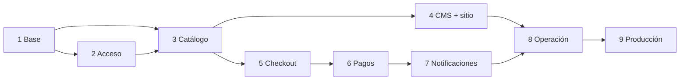

# Plan de desarrollo

Cada fase entrega algo **verificable**. El contrato de API ([api-contract.md](api-contract.md)) y el sistema de diseño se fijan antes, así el frontend avanza en paralelo con datos simulados desde el contrato.

## Alcance

**MVP:** todos los requisitos con prioridad **M** en [requirements.md](requirements.md).
**Si cabe:** prioridad **S** (subcategorías, relacionadas, indicadores, 2FA para todos, "Duplicar como nueva pieza").
**Después del MVP:** recuperación de carrito, dashboard a medida en Next.js, facturación electrónica, cuentas de cliente, envíos internacionales.

## Fases

### Fase 0 — Análisis y requisitos ✅ en revisión
- Los 10 documentos de `docs/`.
- **Hecho cuando:** el cliente aprueba el alcance y la dirección visual; los pendientes que bloquean la Fase 5 y la 6 tienen respuesta o fecha.

### Fase 1 — Base del proyecto
| Tarea | Detalle |
|---|---|
| 1.1 | Estructura del monorepo, `.gitignore`, `.editorconfig`, `README` |
| 1.2 | Backend: Django 5.x, settings `base/dev/prod/test` con `django-environ`, `apps/core` con `Money` y `/api/v1/health/{live,ready}` |
| 1.3 | Frontend: Next.js (App Router, TS estricto), `app/[locale]`, Tailwind con los tokens de DC-06, fuentes del prototipo |
| 1.4 | `infra/docker-compose.dev.yml`: postgres, redis, backend, worker, beat, frontend, caddy, mailpit |
| 1.5 | `Caddyfile`: `/api/*` y admin → Django; `/` → Next; `https://serti.localhost` |
| 1.6 | `.env.example` documentado (todas las variables de [integrations.md](integrations.md)) |
| 1.7 | CI: Ruff, mypy, pytest, `tsc`, ESLint, build de imágenes, `gitleaks`, `pip-audit`, `npm audit` |

**Hecho cuando:** `docker compose up` levanta todo; `https://serti.localhost/api/v1/health/ready` → 200 con BD y Redis; `/es` y `/en` responden; CI en verde.

### Fase 2 — Dashboard: acceso y roles
Unfold, Argon2, `django-axes`, 2FA TOTP, roles (Propietario, Operaciones, Contenido), recuperación de contraseña, `AuditLog`.
**Hecho cuando:** pruebas de permisos por rol y de bloqueo pasan; un cambio en un usuario queda auditado.

### Fase 3 — Catálogo de piezas únicas
Categorías, colecciones, piedras, materiales, piezas con estados, imágenes con WebP (Celery), ocultar piezas (DC-16), reservas con índice único, tabla DANE, API pública de catálogo, búsqueda.
**Hecho cuando:** se cargan piezas de prueba desde el dashboard; la API filtra y busca; la prueba concurrente demuestra que una pieza no se reserva dos veces.

### Fase 4 — Contenido, idiomas y sitio público base
CMS (home por secciones, páginas, revisiones, vista previa con *Draft Mode*), `modeltranslation`, comando de traducciones faltantes; frontend: layout, navegación, home con paneles de piedra, listado, ficha, lista de deseos, páginas legales, personalización (contenido administrable, DC-17), WhatsApp flotante.
**Hecho cuando:** editar el hero → vista previa → publicar → visible en `/es` y `/en`; Lighthouse ≥ 90 en rendimiento y accesibilidad en la ficha.

### Fase 5 — Carrito, checkout y precios
Carrito, `pricing`, cupones y precio rebajado (DC-02, P-04), envío gratis Colombia (DC-01), certificado (DC-15), consentimientos, `POST /orders` idempotente con reserva.
**Hecho cuando:** la tabla de casos de precios pasa; doble clic en "Pagar" crea un solo pedido; pieza reservada por otro → mensaje correcto.

### Fase 6 — Pagos
`WompiChannel` (firma, Widget, webhook, conciliación, pagos asíncronos) y `ManualChannel` (reserva 24 h, confirmación en el dashboard, vencimiento) (DC-14).
**Hecho cuando:** E2E en sandbox — aprobado, rechazado y reintento, pendiente → conciliado, evento falso rechazado, efectivo en corresponsal reservado, pago manual confirmado y pago manual vencido.

### Fase 7 — Notificaciones
Adaptadores de correo y WhatsApp Cloud, plantillas ES/EN, entregas idempotentes, reintentos.
**Hecho cuando:** un pago aprobado genera exactamente un correo al comprador, uno a SERTI y un WhatsApp a SERTI; con el proveedor caído, se reintenta y el pedido sigue pagado.

### Fase 8 — Operación y pulido
Gestión de pedidos en el dashboard (filtros, transiciones, historial), indicadores, estados vacíos/carga/error, revisión visual completa con el cliente en móvil.
**Hecho cuando:** el cliente completa un pedido de punta a punta en *staging* desde su celular y lo gestiona desde el dashboard.

### Fase 9 — Producción
*Hardening* (`check --deploy`, cabeceras, CSP), OWASP ZAP *baseline*, pruebas de carga básicas, backups y prueba de restauración, Sentry, *uptime*, SPF/DKIM/DMARC, despliegue en el VPS con el dominio del cliente (DC-12). **Solo con autorización explícita.**
**Hecho cuando:** checklist de lanzamiento firmado por el cliente.

## Dependencias

## Trámites externos (empezar ya; tardan más que el código)

| Trámite | Responsable | Necesario para |
|---|---|---|
| Cuenta Wompi (sandbox ya; producción con verificación del comercio) | Cliente | Fase 6 |
| Verificación del negocio en Meta + número dedicado para WhatsApp | Cliente | Fase 7 |
| Compra del dominio y DNS apuntando al VPS | Cliente | Fase 9 (antes, *staging*) |
| Proveedor de correo y verificación del dominio | Equipo + cliente | Fase 7 |
| Fotografía de producto (guía en [ux-ui-plan.md](ux-ui-plan.md#guía-de-fotografía-para-el-cliente-dc-07)) | Cliente | Lanzamiento |
| Revisión legal de políticas (datos, devoluciones, términos) | Cliente | Lanzamiento |
| Validación tributaria (P-14) | Contador del cliente | Lanzamiento |

## Definición de "hecho" (toda tarea)
- Pruebas escritas junto con el código y en verde en CI.
- Tipos sin errores (mypy, `tsc`).
- Sin secretos en el código; variables nuevas en `.env.example`.
- Migraciones revisadas (sin pérdida de datos).
- Documentación actualizada si cambia un contrato, un modelo o una decisión.
- Explicación de qué hace el módulo y cómo verificarlo en la descripción del PR.
